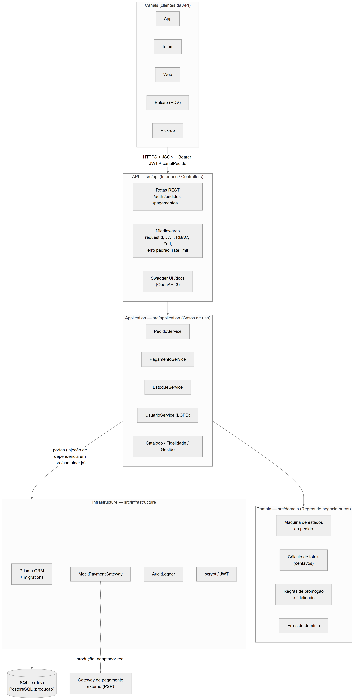

# Raízes do Nordeste — API Back-end

API REST da rede de lanchonetes **Raízes do Nordeste** (matriz + unidades), desenvolvida para o
**Projeto Multidisciplinar — Trilha Back-end (UNINTER, 2026)**.

> Aluno: **Apollo Hoinatz Bardini** — RU **5586086**

A API atende vários canais (**APP, TOTEM, BALCAO, PICKUP, WEB**) e entrega o **Fluxo A completo**:
**Pedido → Pagamento (gateway mock) → Atualização de status**, com estoque por unidade, fidelização com
consentimento (LGPD), promoções, auditoria e relatórios para a matriz.

| Evidência | Onde |
|---|---|
| Repositório | `https://github.com/<SEU-USUARIO>/raizes-do-nordeste-api` |
| Swagger UI (local) | <http://localhost:3000/docs> (rota `/docs`) — JSON em `/openapi.json` |
| Contrato OpenAPI no repositório | [`src/api/docs/openapi.yaml`](src/api/docs/openapi.yaml) |
| Coleção Postman | [`postman/raizes-do-nordeste.postman_collection.json`](postman/raizes-do-nordeste.postman_collection.json) + [`postman/local.postman_environment.json`](postman/local.postman_environment.json) |
| DER e diagramas UML | [`docs/diagramas/`](docs/diagramas) (fonte `.mmd`, imagens `.png`/`.svg`) |
| Plano de testes | [`docs/plano-de-testes.md`](docs/plano-de-testes.md) |
| Deploy | não há (execução local, conforme o roteiro) |

---

## 1. Requisitos

| Item | Versão |
|---|---|
| Node.js | **20 ou superior** (testado no 24.20) |
| npm | 10+ |
| Banco | **SQLite** (arquivo local, criado pelas migrations; não precisa instalar nada) |
| ORM / migrations | Prisma 6.19 |
| Principais dependências | Express 4, Zod, jsonwebtoken, bcryptjs, swagger-ui-express, helmet, express-rate-limit |

## 2. Variáveis de ambiente

```bash
cp .env.example .env        # Windows PowerShell: Copy-Item .env.example .env
```

| Variável | Padrão | Descrição |
|---|---|---|
| `PORT` | 3000 | Porta HTTP |
| `DATABASE_URL` | `file:./dev.db` | Arquivo SQLite (fica em `prisma/dev.db`) |
| `JWT_SECRET` | — | **Obrigatória**, mínimo 32 caracteres |
| `JWT_EXPIRES_IN` | 3600 | Validade do token (segundos) |
| `BCRYPT_ROUNDS` | 10 | Custo do hash de senha |
| `PAYMENT_MOCK_LATENCY_MS` | 150 | Latência simulada do gateway |
| `PAYMENT_MAX_TENTATIVAS` | 3 | Retentativas em falha de comunicação com o gateway |
| `LOGIN_RATE_LIMIT` | 20 | Logins **falhos** permitidos por IP a cada 15 min |

## 3. Instalação, banco e execução

```bash
npm install            # instala dependências e gera o Prisma Client
npm run setup          # aplica as migrations (cria prisma/dev.db) e executa o seed
npm start              # inicia a API em http://localhost:3000
```

- Swagger: **<http://localhost:3000/docs>** → clique em **Authorize** e cole o `accessToken` de `POST /auth/login`.
- Health check: `GET http://localhost:3000/health`.
- Recriar os dados de demonstração a qualquer momento: `npm run db:seed` (o seed limpa e recria tudo).
- Modo desenvolvimento (reinicia ao salvar): `npm run dev`.

### Usuários do seed (senha de todos: `Senha@123`)

| Perfil | E-mail | Unidade |
|---|---|---|
| ADMIN (matriz) | `admin@raizes.com` | — |
| GERENTE | `gerente.recife@raizes.com` | 1 — Recife (cozinha completa) |
| ATENDENTE | `atendente.recife@raizes.com` | 1 |
| COZINHA | `cozinha.recife@raizes.com` | 1 |
| GERENTE | `gerente.sp@raizes.com` | 2 — São Paulo (cozinha reduzida) |
| CLIENTE (com consentimento de fidelidade, 200 pontos) | `maria@cliente.com` | — |
| CLIENTE (sem consentimento) | `joao@cliente.com` | — |

Produtos: 1 Tapioca, 2 Cuscuz (exige cozinha completa), 3 Bolo de macaxeira, 4 Suco de cajá (**só 3 em estoque em Recife**,
para demonstrar o 409), 5 Café, 6 Canjica (sazonal, junho–julho). Promoções: `BEMVINDO10` (10%, rede) e `APP15` (15%, só canal APP).

## 4. Testes

### 4.1 Testes automatizados (40 testes: 10 de domínio + 30 de integração HTTP)

```bash
npm test
```

Usa um banco isolado (`prisma/test.db`), recriado a cada execução (migrations + seed). Não interfere no `dev.db`.

### 4.2 Coleção Postman / Newman (54 requisições, 95 asserts)

1. `npm run db:seed` (dados previsíveis) e `npm start`.
2. **Postman**: *Import* → `postman/raizes-do-nordeste.postman_collection.json` e `postman/local.postman_environment.json`;
   selecione o ambiente **Raizes do Nordeste - Local** e execute a coleção inteira pelo **Runner**, **na ordem**.
   A pasta `00 Setup` faz login com cada perfil e guarda os tokens em variáveis; as demais pastas reutilizam os IDs criados.
3. **Linha de comando**: `npm run test:postman` (executa o Newman via `npx`).

Pastas: `00 Setup`, `01 Auth`, `02 Catalogo`, `03 Pedidos`, `04 Pagamento (mock)`, `05 Status do pedido`, `06 Multicanal`,
`07 Idempotencia, cancelamento e auditoria`, `08 Estoque`, `09 LGPD e Fidelidade`, `10 Matriz e Erros`.
Cada requisição traz o ID do cenário (T01…T30) do [plano de testes](docs/plano-de-testes.md).

## 5. Arquitetura

Organização em camadas (Clean Architecture simplificada), com dependências apontando para o domínio:

```
src/
├── domain/           # Regras de negócio puras: máquina de estados do pedido, cálculo de totais,
│                     # disponibilidade por unidade, promoções, fidelidade, erros de domínio
├── application/      # Casos de uso (services): pedidos, pagamento, estoque, usuários/LGPD,
│                     # catálogo, fidelidade, gestão (auditoria e relatórios) + portas (interfaces)
├── infrastructure/   # Prisma (persistência), MockPaymentGateway, AuditLogger, bcrypt, JWT
├── api/              # Rotas REST, middlewares (JWT, RBAC, Zod, requestId, erro padrão), OpenAPI
├── container.js      # Composition root: injeta as implementações de infraestrutura nos casos de uso
├── app.js            # Monta o Express
└── server.js         # Sobe o servidor com encerramento gracioso
prisma/               # schema.prisma, migrations/, seed.js
tests/                # node:test + supertest
postman/              # coleção + ambiente
docs/                 # diagramas (casos de uso, DER, classes, sequência, estados, arquitetura) e plano de testes
```



## 6. Endpoints (resumo — contrato completo no Swagger)

| Recurso | Método e rota | Perfis |
|---|---|---|
| Auth | `POST /auth/login` | público |
| Usuários | `POST /usuarios` (cliente público; funcionário só ADMIN) · `GET /usuarios/me` · `GET /usuarios/me/dados` · `PUT /usuarios/me/consentimentos` · `DELETE /usuarios/me` · `GET /usuarios` · `GET /usuarios/{id}` | variados |
| Unidades | `GET /unidades` · `GET /unidades/{id}` · `GET /unidades/{id}/cardapio` · `POST /unidades` | público / ADMIN |
| Produtos | `GET /produtos` · `GET /produtos/{id}` · `POST` · `PUT /produtos/{id}` · `DELETE /produtos/{id}` | público / ADMIN |
| Promoções | `GET /promocoes` · `POST /promocoes` | público / ADMIN |
| Estoque | `GET /estoque?unidadeId=` · `POST /estoque/movimentacoes` · `GET /estoque/movimentacoes` | equipe da unidade / GERENTE / ADMIN |
| Pedidos | `POST /pedidos` · `GET /pedidos?canalPedido=&status=` · `GET /pedidos/{id}` · `PATCH /pedidos/{id}/status` · `POST /pedidos/{id}/cancelamento` · `GET /pedidos/{id}/pagamentos` | CLIENTE / ATENDENTE / COZINHA / GERENTE / ADMIN |
| Pagamentos | `POST /pagamentos` · `GET /pagamentos/{id}` | dono do pedido / equipe |
| Fidelidade | `GET /fidelidade/saldo` · `GET /fidelidade/extrato` | CLIENTE |
| Matriz | `GET /auditoria` · `GET /relatorios/vendas` | ADMIN / GERENTE |

### Padrão de erro (todas as falhas)

```json
{
  "error": "ESTOQUE_INSUFICIENTE",
  "message": "Nao ha quantidade suficiente para um ou mais itens.",
  "details": [{ "field": "itens[0].quantidade", "issue": "Disponivel: 3" }],
  "timestamp": "2026-11-09T12:00:00.000Z",
  "path": "/pedidos",
  "requestId": "2af099bd-a786-436c-8154-7240b9f7f431"
}
```

Códigos: 200, 201, 204, 400 (JSON malformado), 401, 403, 404, 409 (conflito/regra), 422 (validação/regra), 429, 503 (gateway).

### Pagamento mock — tokens de teste (`tokenPagamento`)

| Token | Resultado |
|---|---|
| `tok_aprovado` (padrão) | APROVADO → pedido `PAGO` + pontos (com consentimento) |
| `tok_recusado` | RECUSADO (`SALDO_INSUFICIENTE`) → pedido `PAGAMENTO_RECUSADO` |
| `tok_cartao_bloq` | RECUSADO (`CARTAO_BLOQUEADO`) |
| `tok_instavel` | falha na 1ª chamada e aprova no retry |
| `tok_indisponivel` | 3 falhas → tentativa `ERRO` + **503**; pedido continua `AGUARDANDO_PAGAMENTO` |

### Exemplo rápido (curl)

```bash
TOKEN=$(curl -s -X POST localhost:3000/auth/login -H "Content-Type: application/json" \
  -d '{"email":"maria@cliente.com","senha":"Senha@123"}' | node -pe "JSON.parse(require('fs').readFileSync(0)).accessToken")

curl -s -X POST localhost:3000/pedidos -H "Authorization: Bearer $TOKEN" -H "Content-Type: application/json" \
  -H "Idempotency-Key: 3f0c2a9e-7d1b-4c61-9a52-2c8e1f7b6d10" \
  -d '{"canalPedido":"APP","unidadeId":1,"itens":[{"produtoId":1,"quantidade":2}],"formaPagamento":"PIX"}'

curl -s -X POST localhost:3000/pagamentos -H "Authorization: Bearer $TOKEN" -H "Content-Type: application/json" \
  -d '{"pedidoId":1,"tokenPagamento":"tok_aprovado"}'
```

## 7. Segurança e LGPD (resumo)

- Senhas com **bcrypt**; nenhuma resposta expõe `senhaHash`; JWT HS256 com expiração e só `sub`/`perfil`/`unidadeId`.
- **RBAC** por perfil + escopo por unidade (funcionário só opera a própria unidade; cliente só vê os próprios pedidos — terceiros recebem 404).
- **Consentimento** explícito e versionado (histórico imutável) para o programa de fidelidade; sem consentimento não há acúmulo nem resgate.
- Direitos do titular: **exportação** (`GET /usuarios/me/dados`) e **eliminação por anonimização** (`DELETE /usuarios/me`), mantendo pedidos para obrigação fiscal.
- **Auditoria** (`audit_logs`) de login, cancelamentos, mudanças de status, pagamentos, estoque, acesso/exportação/anonimização de dados — com `requestId` e IP, sem dados sensíveis.
- Minimização: não coletamos CPF, endereço nem data de nascimento; listagens administrativas mascaram e-mail.
- `helmet`, CORS, limite de 100 kB no corpo, rate limit em logins falhos, logs de acesso estruturados sem corpo da requisição.

## 8. Decisões e limitações

- **SQLite** foi escolhido para a correção rodar sem instalar servidor de banco. Em produção: PostgreSQL (trocar o `provider` no `schema.prisma` e gerar nova migration).
- Gateway de pagamento é **simulado** (`src/infrastructure/payment/mockPaymentGateway.js`); um provedor real exige apenas outro adaptador registrado em `src/container.js`.
- Propostas (não implementadas): refresh token/logout com lista de revogação, webhook assinado do gateway, expiração automática de pedidos não pagos, cache do cardápio e fila para pagamentos em horário de pico.

## Licença

MIT
